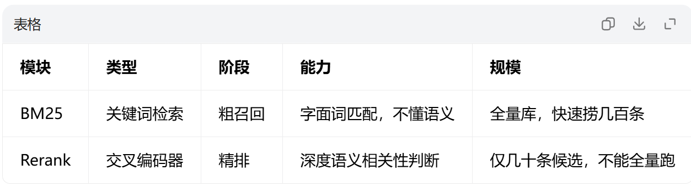
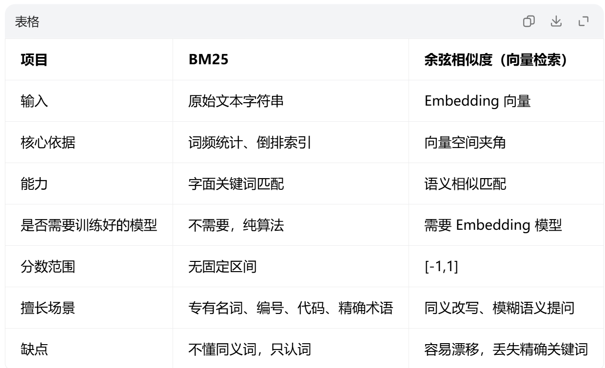
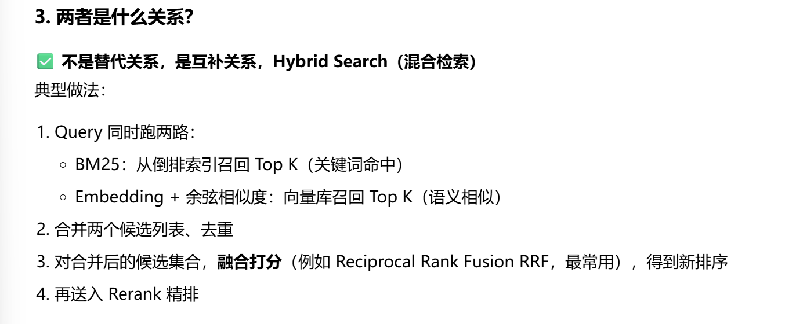
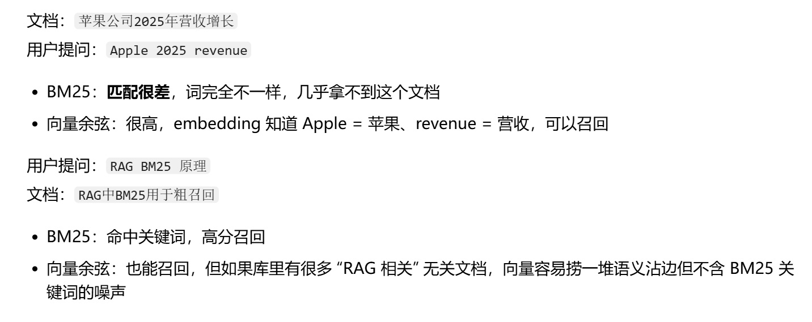

# 用了最好的rerank重排算法,内测效果很好,灰度第三天翻车,最慢用户等3.4秒,老搜索只要300ms,三成用户没等到首次回答就滑走了
延迟经过部门解析,大头在重排那里. 效果是天花板,但延迟才是门票,太慢了效果再好也没用
(几个概念:
召回: 先捞出可能相关的候选
cross-encoder:逐对精算,最准最慢
rerank:读完全文再排,秒级
late-interaction:提前算好
)

# ai搜索要加rerank,先看延迟,成本还是效果
混合检索后要不要加reranker,带来的收益和额外延迟怎么算账

回答: 先看延迟,再看成本,效果放最后
查询rag,得到topk条内容后,读完全文再排(多条件,口语化的问题最吃这个),效果会很好
但大模型读完几十条候选才开口,延迟秒级起步,用户等得很烦

# rag前置知识
## 完整rag链路
1. 文档切片（Chunk）
2. 向量化入库（向量库） + 建立BM25倒排索引
3. 用户提问
4. 【粗召回】
   - 向量召回：语义相似片段
   - BM25召回：关键词匹配片段
   → 两路结果合并、去重，得到候选池（比如50条）
5. 【Rerank精排】
   把候选池送入Reranker，按真实相关性重新排序，截取TopN（3~5条）
6. 把精选片段 + 用户问题 组装Prompt送入LLM
7. LLM输出答案

### BM25是什么
BM25(best matching 25 经典关键词检索算法):基于词频,逆文档频率,计算查询词和文档相关性分数
通过关键词匹配,查看你的问题里的词在文档里出现的情况
优点: 快
缺点: 不懂语义,同义词或转述匹配不到,不理解上下文

粗召回(从海量文档里捞一批相关候选):
Rerank重排: 精排序(对召回出来的少量候选打分,选出最贴合问题的topN):
Rerank 模型（比如 BGE-Reranker、CrossEncoder、Cohere Rerank）是**交叉编码器（Cross-Encoder）**。
输入：`[用户问题，单条候选文档片段]`，输出一个相关性分数。

> 
> 本质：**精细判断「这一段文档到底能不能回答这个问题」**，深度理解语义。

> 
> 
第一阶段: 粗召回
    用户Question → BM25检索 → 拿出Top-K候选文档（比如Top20/Top50）
第二阶段: 精排Reranking
    BM25召回Top50 → Rerank模型逐个打分 → 取Top3~Top5最相关片段 → 塞进Prompt给LLM生成答案

**BM25 不能替代向量检索**：缺语义；向量检索容易丢失专有名词，两者搭配是主流方案。

# BM25和余弦相似度关系
两者都是相关性打分,但原理不同. BM25是关键词统计,余弦相似度是向量空间语义距离.一般做两路召回,混合使用.余弦相似度对全量用,bm25对rag召回的数据用

Bm25原理:
    基于**词袋 + 词频 TF-IDF 改良**，依赖倒排索引。

> 
> 输入：原始文本（query、文档）
> 计算：query 里每个词在文档里的出现次数、文档长度、词的稀有度，算出相关性分数。
> 特点：**只看词的字面重合，不理解语义**；词换同义词就匹配不到。
> 输出：BM25 score（分数没有固定范围，不同文档库分数不能直接横向对比）
> 

余弦相似度原理:
    作用在**Embedding 向量**上。
先把 query 和文档 chunk 分别用 Embedding 模型转为固定维度向量；
余弦 = 两个向量夹角余弦值：

\(\cos(\theta)=\frac{\vec{a}\cdot\vec{b}}{|\vec{a}| |\vec{b}|}\)> 
> 范围：`[-1,1]`，RAG 场景一般是`[0,1]`，越接近 1 代表越相似。
> 特点：**捕捉语义**，同义词、转述句子向量也能靠近；但不擅长精确专有名词匹配。
> 缺陷：向量是全局压缩表征，容易出现 “语义上看起来相近，但关键词完全不对” 的假阳性。
> 

关系:

例子:

